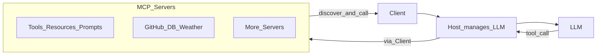

# 07 | 💬 תקשורת ופרוטוקולים – Model Context Protocol (MCP)

> **מבנה מפגש:** פתיחה 10' · תאוריה 25' · דמו בחלון 15' · Lab Server/Client 30' · תרגול 15' · סיכום 10'  
> **חטיבה 2** · מצטבר ל-**פרויקט 2**  
> **דמו:** [`demos/07-mcp`](../demos/07-mcp/README.md) · **שיעורי בית:** [07-שיעורי-בית.md](07-שיעורי-בית.md)

---

## 🌟 הקדמה

**MCP** – Model Context Protocol: פרוטוקול לאספקת קונטקסט למודל. פותח ע"י Anthropic והפך במהירות לסטנדרט בתעשייה.

MCP **לא המציא** שום דבר חדש. אפשר ליישם את מה שהוא עושה גם בלעדיו – אבל איתו זה **פשוט יותר, ניתן לשימוש חוזר ולניהול יעיל**.

במשפט אחד: MCP בא לעשות סדר ולנרמל את האופן שבו אנחנו מספקים ל-LLM שירותים חיצוניים כדי להרחיב את הקונטקסט שלו.

> **משפט עוגן:** אנחנו לא יודעות מראש איזה Tool ייבחר – המודל בוחר. ה-Host שואל את השרת מה יש, ומריץ.

---

## ➕ למה LLM צריך עוד קונטקסט?

המודל הוא יצור מרשים, אבל יש לו גבולות – ואלה לא באגים, אלא מהות המודל.

### 1. העשרה במידע
- המודל אומן על מידע עד נקודת זמן מסוימת. הוא לא יודע מה השתנה מאז.
- מידע **אישי או פנימי** (חשבון לקוחה, נהלי חברה) לא היה באימון.
- מקורות שונים, גרסאות שונות – והמשתמשת מצפה למיקוד בפלח מסוים.

### 2. הפעלת פעולות
המודל הוא **"מוח"**: חשיבה, תובנות, תוכן. הוא **לא** שולח מייל, לא מריץ קוד ולא מתחבר לשירותים בעצמו. הוא יכול *לנסח* מייל – לא *לשלוח* אותו.

הפתרון לשני החסרים: **הרחבת הקונטקסט** של המודל.

---

## 🔨 Function Calling (חזרה על שיעור 1)

1. יש פונקציות רגילות: `send_email(to, subject, body)`.
2. אנחנו מספקים למודל **תיאור** של הפונקציות (Tools) יחד עם המשימה.
3. המודל **לא מריץ** – הוא מחזיר **הוראה**: «הפעילי `send_email` עם הפרמטרים האלה».
4. אנחנו מריצות ומחזירות לו את התוצאה.

> «נסח מייל ללקוחה עם הצעת מחיר ושלח אותו ב-8 בבוקר» – הניסוח הוא התחום של המודל. השליחה היא של הפונקציה.

עם Function Calling אפשר להפעיל כל קוד: API חיצוני, DB, פקודות.

---

## 🖼️ MCP נכנס לתמונה

MCP מבוסס על Function Calling, ומגדיר **סטנדרט אחיד** לחיבור פונקציות חיצוניות ל-LLM.

| בלי MCP | עם MCP |
|---------|--------|
| כל פרויקט כותב מחדש את חיבור ה-Tools | מתאימים לפרוטוקול ומתמקדים במימוש |
| קשה לארוז ולהפיץ | שרת אחד – הרבה צרכנים (reuse) |
| כל Host מכיר את הפונקציות בקוד | ה-Host **מגלה** אותן ב-`list_tools` |

אנלוגיה: **שקע חשמל אחיד.** לא בונים מתאם לכל מכשיר.

---

## 🐵 השחקנים הראשיים




| שחקן | תפקיד | דוגמאות |
|------|--------|---------|
| **Host** | האפליקציה שמנהלת את השיחה עם ה-LLM; מחזיקה Clients | Cursor, Claude Desktop, צ'אט מותאם, Agent |
| **Client** | רכיב **גנרי** בתוך ה-Host. Client אחד לכל Server | התחברות · גילוי · הפעלה |
| **Server** | מספק את הקונטקסט | Weather, GitHub, DB, Filesystem |

### 🏠 Host
מנהל את השיחה מול ה-LLM. ברגע שחיברנו Server, הוא מצרף את רשימת ה-Tools שלו **בכל קריאה** ל-LLM:

*«LLM יקר, הנה המשימה והנה ארגז הכלים. אם אתה רואה צורך, תן הוראה להפעיל כלי מהרשימה, ונדאג להריץ אותו.»*

### 🔌 Client
רכיב גנרי שמתאים לכל Server, ועושה שלושה דברים:

1. ⚡ **התחברות** לשרת
2. ⚡ **גילוי** Tools (וגם Resources ו-Prompts)
3. ⚡ **הפעלת** Tool

### 🧰 Server – שלושה סוגי יכולות

| סוג | תיאור | דוגמה |
|-----|--------|-------|
| **Tools** | פונקציות: API, DB, כל פעולה | `lookup_bill(customer_id)` |
| **Resources** | מקורות נתונים לקריאה | קובץ, טבלה, מסמך |
| **Prompts** | תבניות פרומפט מוכנות | «סכמי שיחת שירות» |

```text
Host ──► מצרף רשימת Tools לכל קריאה ל-LLM
LLM  ──► Tool Call (שם + args)            ← המודל בוחר
Client ──► call_tool אל ה-Server
Server ──► מריץ ומחזיר תוצאה
Host  ──► מחזיר Observation למודל ──► תשובה
```

---

## 🌐 Local מול Remote

| | Local | Remote |
|---|-------|--------|
| מקום | המחשב של המשתמש | שרת מרוחק / ענן |
| גישה | קבצים מקומיים, סביבת פיתוח, הרצת פקודות | משאבי ענן ארגוניים, DB מרכזי, SaaS |
| מהירות | Latency נמוך | רשת |
| אבטחה | המידע לא עובר ברשת | פרוטוקול מאובטח (HTTPS) |
| ניהול | התקנה לכל משתמשת | עדכון מרכזי ושיתוף |
| תקשורת | **stdio** (Client מריץ את השרת כתהליך) | **HTTP** |

בחירה לפי **רגישות המידע** וצורך בענן.

---

## 🎬 הדמו בכיתה (חלון Gradio)

תיקייה: [`demos/07-mcp`](../demos/07-mcp/README.md). אותה בקשה פעמיים – **בלי MCP** ו**עם MCP**.

| # | בקשה | בלי MCP | עם MCP |
|---|------|---------|--------|
| 1 | לקוחה 312 חויבה פעמיים. מה מגיע לה? | «החזר מלא מיד» – בלי לראות חשבון | `list_tools` → `lookup_bill` → `lookup_policy` → «חיוב אחד תוך 5 ימי עסקים» |
| 2 | לקוחה 100 חויבה פעמיים | אותה המצאה | אותו מסלול, תוצאה אחרת: חיוב אחד, אין החזר |
| 3 | מה מזג האוויר? | מנחש | אין Tool מתאים – לא מופעל כלום |

קבצים להראות: `server.py` → `client.py` → `ask_the_model.py` → `app.py`.

---

## 🛠️ שלבי Lab

> דוגמת הקורס: **Weather MCP** – שרת שמספק תחזית מזג אוויר (API של `api.weather.gov`, ארה"ב בלבד). מזג אוויר משתנה כל הזמן, ולכן אין ל-LLM דרך לענות בלי כלי כזה.

### שלב 1 – MCP Server
שתי פונקציות, כל אחת עם `@mcp.tool()` שהופך אותה לניתנת לגילוי והפעלה:

- `get_forecast(latitude, longitude)` – תחזית למיקום
- `get_alerts(state)` – התראות על אירועי מזג אוויר

```python
from mcp.server.fastmcp import FastMCP
mcp = FastMCP("weather")

@mcp.tool()
def get_forecast(latitude: float, longitude: float) -> str:
    """תחזית מזג אוויר לפי קואורדינטות."""
    ...

if __name__ == "__main__":
    mcp.run(transport="stdio")
```

> **Gotcha:** בשרת stdio **אסור `print`**. ה-stdout הוא ערוץ הפרוטוקול. לוגים – ל-stderr.

השרת רץ **לוקלית** על מחשב המשתמשת.

### שלב 2 – MCP Client
רכיב גנרי שמחזיק `session`. הפונקציה `connect_to_server(path)` מקבלת נתיב לקובץ השרת, **מריצה אותו כתהליך** (`python server.py`), ופותחת ערוץ stdio שעליו מתנהל ה-session.

ב-Host יהיה מופע Client **לכל** Server.

### שלב 3 – Host
צ'אט קליל בטרמינל:

1. רשימת מופעי Client
2. `list_tools` לכל Server (דרך ה-Client)
3. בכל קריאה ל-LLM – מצרפים את ה-Tools
4. **לולאה:** אם התשובה היא טקסט → מציגים. אם היא `tool_use` → מפעילים עם ה-args ומחזירים למודל.

**הערות:**
- אנחנו **לא יודעות** איזה Tool ייבחר – המודל בוחר.
- בקריאה הראשונה המודל בדרך כלל מחזיר רק הוראת הפעלה. **אחרי** שהתוצאה חוזרת, הוא מנסח תשובה (סבב שני). זה רגיל.
- אפשר כמה סבבי Tools ברצף (כמו בדמו: חיוב ואז מדיניות).

### שלב 4 – חיבור לאפליקציית צ'אט
אפליקציית ChatBox: מגדירים חיבור ל-LLM (למשל Gemini + API Key) וחיבור ל-Server לוקלי בפקודה כמו:

```text
uv --directory C:\Users\user1\...\mcp-server-folder run mcp_server.py
```

שואלים «מה התחזית להיום בשיקגו?» ורואים ש-`get_forecast` הופעל.

### שלב 5 – Edge cases
- Tool נכשל / API לא זמין → מחזירים הודעת שגיאה קריאה למודל (לא קורסים).
- הלולאה בלי תקרה → הגבילו מספר סבבים (בדמו: 4).
- שני Tools עם תיאורים דומים → המודל מתבלבל. חדדו את ה-docstring.

### 💡 שדרוג
תחליפי את ה-API האמריקאי בשירות המטאורולוגי הישראלי – ותעזרי ליושבי הארץ להחליט מה ללבוש.

---

## 🎭 פרויקט מורחב: MCP עם Playwright

MCP ששם ל-LLM **יד על העכבר**. במקום API, ה-Server **פותח דפדפן** ומשיג תחזית מהאתר `weather2day.co.il/forecast`, בשלוש פעולות של Playwright:

| Tool | מה עושה |
|------|---------|
| `open_weather_forecast_israel` | פותח דפדפן ומנווט לדף |
| `enter_weather_forecast_city_israel` | מזין שם עיר בשדה |
| `select_weather_forecast_city_israel` | בוחר את הפריט הראשון ברשימה |

שלב ב': Tool נוסף שמחלץ את תוכן הדף ומנקה אותו, כדי שהמודל יענה בעצמו. **ניחשת – זה RAG.**

**Gotcha:** חיפוש בגוגל דרך Playwright מקפיץ Captcha. חיפוש אינטרנט נעשה עם מנוע כמו **Tavily**, לא בפתיחת דפדפן. ולפעולות דפדפן גנריות כבר יש MCP רשמי של Playwright.

תבנית: `github.com/malbruk/dovrot-ai-projects/tree/master/08-mcp/project-template` (`client.py`, `host.py`, `weather_USA.py`, `weather_Israel.py`). הרצה: `uv sync` · `uv run playwright install chromium` · `uv run host.py`.

---

## 📌 שיקולים

| שיקול | שאלה |
|-------|------|
| **אבטחת מידע** | אילו כלים מסוכנים? הרשאות, קריאה בלבד, אישור לפני כתיבה. תוכן שחוזר מ-Tool הוא **מידע לא אמין** – ראו Prompt Injection בשיעור 13 |
| **העמסת הקשר** | כל Tool תופס טוקנים בכל קריאה. יותר מדי = בלבול + Context Rot |
| **בחירת Tool נכון** | תיאורים (docstring) טובים וייחודיים |
| **שקיפות** | לוג של כל Tool call – מי הפעיל מה |

**MCP Registry** – המאגר הרשמי של שרתי MCP. **האתר הרשמי:** Model Context Protocol.

---

## 📊 MCP מול Skills מול RAG

| | **MCP** | **Skills** (06) | **RAG** (05) |
|---|---------|-----------------|--------------|
| מה מספק | **גישה** לפעולות ולנתונים בחוץ | **נוהל** – איך לעבוד | **ידע** מהמאגר |
| מקור | שרת (Tools/Resources/Prompts) | תיקיית SKILL.md | Vector DB |
| איך נבחר | המודל בוחר Tool | המודל בוחר לפי description | דמיון סמנטי לשאלה |

במערכות אמיתיות משלבים: Skill אומר **איך**; MCP נותן **במה** לגעת.

---

## 🧩 תכולה

- למה MCP נהיה תקן
- Host / Client / Server
- Tools / Resources / Prompts
- Local מול Remote (stdio / HTTP)
- לולאת tool use, כולל כמה סבבים
- Weather MCP + Playwright (הרחבה)

---

## 💡 טיפים ו-Gotchas

- אפשר לממש Function Calling בלי MCP – אבל קשה ל-reuse ולהפצה.
- בשרת stdio: **בלי `print`**.
- כמה Servers → כמה Clients ב-Host (ב-LangChain: `MultiServerMCPClient`, שיעור 9).
- Skills משלימים – לא מחליפים – את MCP.
- ה-docstring של ה-Tool הוא ה-API מול המודל. כתבו אותו בקפידה.

---

## ✅ לסיכום

- MCP = סטנדרט להרחבת קונטקסט המודל, מבוסס על Function Calling.
- שלושה שחקנים: **Host** מנהל, **Client** מתחבר, **Server** מספק.
- ה-Host **מגלה** Tools ב-`list_tools` ומצרף אותם לכל קריאה; המודל בוחר; אנחנו מריצות.
- Local (stdio) לפרטיות ומהירות; Remote (HTTP) לארגון ושיתוף.
- בפרויקט 2 תחברו Server חיצוני לאייג'נט המחקר.

---

## 👩‍💻 קוד / קישורים

- דמו הכיתה: [`demos/07-mcp`](../demos/07-mcp/README.md)
- Weather MCP: `11 MCP Example` · Playwright: `12 MCP with Playwright - Project`
- תרשים: [`../assets/mcp-client-tools-flow.png`](../assets/mcp-client-tools-flow.png)
- Weather API (ארה"ב): `api.weather.gov` · השירות המטאורולוגי הישראלי

---

## 🏠 תרגיל בית

1. **שיעורי בית 07** – אותו דמו, עם MCP Server של ספרייה עירונית: [07-שיעורי-בית.md](07-שיעורי-בית.md).
2. **התקדמות בפרויקט 2** – תעדו אילו Tools נחשפו (`list_tools`) בשרת שהרצתן, ותכננו איזה MCP ייכנס ל-Research Agent (ולמה). כתבו סיכון אבטחה אחד ואיך מצמצמות אותו.

---

## 📎 מקורות

- `MCP - הקדמה`, `MCP - סיכום אישי`, `10 MCP`, `11 MCP Example`, `12 MCP with Playwright - Project`
- שיעור 1 (Function Calling) · שיעור 6 (Skills)
